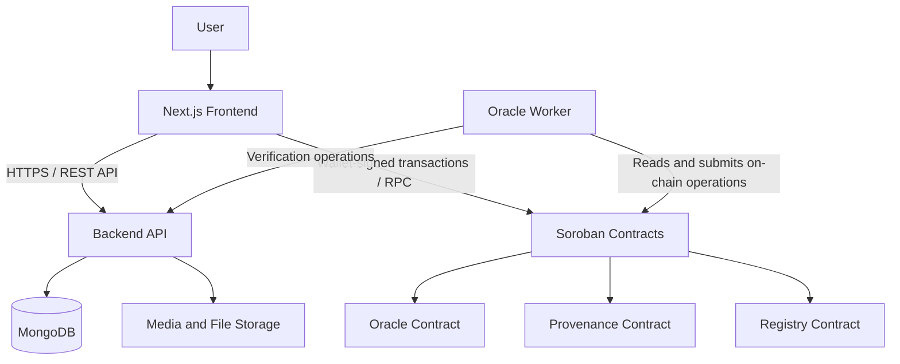

# Monorepo Workspace Setup

This document explains how the StellarProof repository is organized as a pnpm workspace and how the frontend interacts with the backend, Oracle Worker, shared packages, services, and Soroban smart contracts.

## 1. Package Manager

The repository uses **pnpm**.

The root `package.json` declares:

```json
{
  "packageManager": "pnpm@10.18.2"
}
```

Use the declared pnpm version when working on the repository to keep dependency installation and workspace behavior consistent.

Install dependencies from the repository root:

```bash
pnpm install
```

For CI or reproducible local installation:

```bash
pnpm install --frozen-lockfile
```

The root lockfile is:

```text
pnpm-lock.yaml
```

Do not create separate lockfiles for workspace packages unless the project maintainers intentionally change the package-management strategy.

## 2. Workspace Configuration

**File:** `pnpm-workspace.yaml`

The current workspace configuration is:

```yaml
packages:
  - "frontend"
  - "backend"
  - "oracle-worker"
  - "packages/*"
  - "services/*"
```

These patterns define the pnpm workspace package locations.

| Workspace pattern | Responsibility |
|---|---|
| `frontend` | Next.js user interface |
| `backend` | Backend API and business logic |
| `oracle-worker` | Off-chain Oracle Worker |
| `packages/*` | Shared packages |
| `services/*` | Additional service packages |

The wildcard patterns allow packages to be added under the corresponding directories without changing the workspace configuration for every new package.

The Soroban contracts under `contracts/` are not included in the current pnpm workspace patterns. They are Rust/Cargo projects and are built through the Rust toolchain.

## 3. Repository Structure

The relevant high-level structure is:

```text
StellarProof/
├── .github/
│   └── workflows/
│       └── ci.yml
├── backend/
│   ├── package.json
│   ├── src/
│   └── ...
├── contracts/
│   ├── oracle/
│   ├── provenance/
│   └── registry/
├── frontend/
│   ├── app/
│   ├── components/
│   ├── context/
│   ├── features/
│   ├── hooks/
│   ├── services/
│   ├── utils/
│   ├── docs/
│   └── package.json
├── oracle-worker/
├── packages/
├── services/
├── package.json
├── pnpm-lock.yaml
├── pnpm-workspace.yaml
└── tsconfig.base.json
```

Some workspace directories may contain multiple packages or subdirectories. The structure above illustrates the main repository boundaries rather than every file.

## 4. Frontend Workspace

**Directory:** `frontend/`

The frontend package is named `web` in `frontend/package.json`.

Its package metadata includes:

```json
{
  "name": "web",
  "version": "0.1.0",
  "private": true
}
```

The frontend is responsible for:

- Rendering the StellarProof web application.
- Managing user interactions and frontend state.
- Providing verification and certificate-related interfaces.
- Connecting to supported Stellar wallets.
- Communicating with backend APIs.
- Interacting with the Stellar network where required.

The frontend uses Next.js, React, TypeScript, and the dependencies declared in `frontend/package.json`.

### Running frontend workspace commands

From the repository root:

```bash
pnpm --filter web run dev
```

Run its lint script:

```bash
pnpm --filter web run lint
```

Build the frontend:

```bash
pnpm --filter web run build
```

The `--filter web` selector tells pnpm to execute the command in the workspace package whose name is `web`.

## 5. Backend Workspace

**Directory:** `backend/`

The backend package is named:

```text
@stellarproof/backend
```

It provides backend API and business logic, including server-side operations and integrations.

The frontend and backend communicate over HTTP APIs. The frontend should use the existing service and API integration patterns instead of directly accessing backend database resources.

### Running backend commands

Build the backend:

```bash
pnpm --filter @stellarproof/backend run build
```

Run the backend development server:

```bash
pnpm --filter @stellarproof/backend run dev
```

Run backend tests:

```bash
pnpm --filter @stellarproof/backend run test
```

## 6. Oracle Worker

**Directory:** `oracle-worker/`

The Oracle Worker is a separate workspace boundary from the frontend and backend.

At the system level, the worker participates in off-chain verification operations and communicates with the Stellar/Soroban environment.

The frontend should not implement worker responsibilities inside browser components. Worker execution and its associated secrets or privileged operations belong in the appropriate server-side environment.

Use the Oracle Worker's own package scripts and configuration when developing it.

## 7. Shared Packages and Services

The workspace also includes these package patterns:

```text
packages/*
services/*
```

These patterns allow shared libraries and independently maintained services to participate in the pnpm workspace.

When adding or changing a shared package:

1. Inspect the package's own `package.json`.
2. Confirm its exported entry points.
3. Check which workspace packages consume it.
4. Preserve compatible imports and public APIs.
5. Avoid duplicating shared business logic in the frontend.

Do not assume that every directory under these patterns is automatically a dependency of the frontend. A package must be declared or imported by a consuming package to be used there.

## 8. Soroban Smart Contracts

**Directory:** `contracts/`

The repository contains three contract projects:

```text
contracts/
├── oracle/
├── provenance/
└── registry/
```

Each contract is a Rust/Cargo project with its own `Cargo.toml`.

The contracts provide the blockchain-side functionality of StellarProof. They are separate from the pnpm JavaScript/TypeScript workspace.

The frontend can interact with Soroban through the Stellar SDK and supported wallet integrations. It should not attempt to perform contract execution as a replacement for the contract's own validation and authorization logic.

### Building contracts

The root package defines:

```bash
pnpm run build:contracts
```

This script invokes:

```bash
stellar contract build
```

for the Oracle, Provenance, and Registry contract directories.

The GitHub Actions CI workflow also builds the contracts with Cargo and the `wasm32-unknown-unknown` target.

## 9. How the Application Boundaries Work Together

The following diagram describes the major system boundaries.



### Frontend to Backend

The frontend communicates with backend functionality through HTTP APIs.

Typical responsibilities include requesting application data and initiating server-side operations.

### Frontend to Soroban

The frontend can interact with the Stellar network through the Stellar SDK and wallet integrations.

User-authorized transactions should be signed through the supported wallet flow.

### Backend and Oracle Worker

The backend handles server-side application operations, while the Oracle Worker performs its designated off-chain verification responsibilities.

### Soroban Contracts

The Oracle, Provenance, and Registry contracts implement the on-chain responsibilities of the system.

## 10. Root Package Scripts

The root `package.json` currently defines these scripts:

| Script | Command or purpose |
|---|---|
| `test` | Placeholder that exits with an error; not the frontend test command |
| `prepare` | Runs Husky setup |
| `check:frontend` | Runs the frontend lint script |
| `build:frontend` | Runs the frontend production build |
| `build:contracts` | Builds the three Soroban contracts using Stellar CLI |

Use package-specific commands when working on a particular workspace package.

## 11. Workspace Development Guidelines

- Run pnpm commands from the repository root when using workspace filters.
- Use the package name in `--filter`, not an assumed directory name.
- Keep package dependencies in the package that actually uses them.
- Preserve the root `pnpm-lock.yaml`.
- Avoid introducing duplicate package managers or lockfiles.
- Keep frontend-only code inside `frontend/`.
- Keep backend-only code inside `backend/`.
- Keep contract source and Cargo configuration inside the relevant contract directory.
- Do not move Rust contracts into the pnpm workspace unless the workspace configuration is intentionally redesigned.
- Check the CI workflow before changing shared build or package configuration.

## 12. Useful Workspace Commands

Install all workspace dependencies:

```bash
pnpm install
```

Install using the existing lockfile:

```bash
pnpm install --frozen-lockfile
```

Run frontend development:

```bash
pnpm --filter web run dev
```

Run frontend lint:

```bash
pnpm --filter web run lint
```

Build frontend:

```bash
pnpm --filter web run build
```

Build backend:

```bash
pnpm --filter @stellarproof/backend run build
```

Build all three Soroban contracts through the root script:

```bash
pnpm run build:contracts
```
